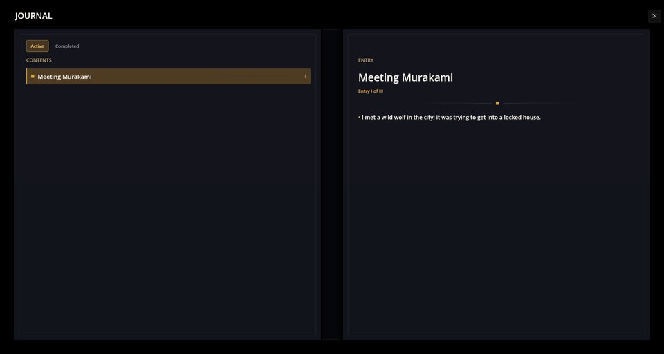

# Cthangover: Murakami — 主游戏的一条剧情线

本模组为 Cthangover 增加一条剧情线：镇上有野兽潜行，循着踪迹走去，就会与村上相遇。它带来相遇的剧本、作为角色的村上（含立绘和一组表情）、一个日志任务以及战斗。它是 Cthangover 游戏的一部分，需要基础剧情（`cthangover_game`）才能运行。

本页说明这条线如何接入游戏、如何开始；之后发生什么，就留给玩家自己去发现了。

## 剧情如何开始

当马劳走到小镇入口时，黑暗中传来一阵低吼，玩家可以选择回家，或者去小巷查看：

![夜晚的小镇入口：文本“[黑暗中传来一声低沉的吼声]”，选项为“回家”和“查看小巷”。](assets/growl.jpg)

选择查看小巷会启动任务“与村上相遇”，它的第一条记录会出现在日志里：



## 剧情线如何接入基础剧情

本模组不改动基础游戏的任何文件。它向现有场景添加剧本，游戏按优先级和条件选择要播放的那一个：

```scenario
scene: town_entry
priority: 10
condition: MeetingMurakamiQuest.notHasTag("wolf_battle")
```

- 开场剧本属于场景 `town_entry`，优先级为 10，因此在条件成立期间，它会优先于小镇的普通剧本被选中。
- 剧情线的每个后续步骤都是 `town_entry` 的另一个剧本，优先级更高（20、30），其条件会检查任务 `MeetingMurakamiQuest` 的标签。最后一步在屋内进行（`home_vestibule`）。
- 战斗通过 `battle.init` 在平台的战斗系统上发起，结果会写回为任务标签，下一个剧本由此知道发生了什么。
- 剧情线结束后，它的条件不再成立，小镇重新播放自己的普通剧本。

模组包含哪些内容：

- `scenarios/murakami/meeting/` —— 相遇的四个剧本；
- `quests/quests.json` —— 带三条日志记录的任务；
- `characters/player/murakami.json` —— 作为角色的村上，带图片；
- `avatars/murakami/` —— 她在对话中用到的表情；
- 相遇场景的背景图，位于 `backgrounds/town/meetingmurakami/`；
- 七种语言的文本，位于 `locale/`。

## 如何停用

可以不把这条线放进游戏的合集：小镇就只播放自己的普通剧本，任务也不会出现。

## 已知问题

- 这些剧本用到的马劳的两种表情 `marao/what` 和 `marao/relax` 在游戏中并不存在，因此对应的行不显示立绘。验证器会把它们报告为 `REF_NOT_FOUND`。
